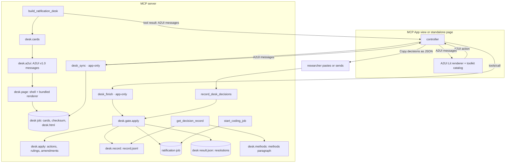

# Design Document

## Overview

The desk is a new subpackage, `ai_anthro_toolkit/desk/`, behind three new model-visible MCP tools and
two app-only tools. The server builds each desk from records it already holds (a codebook job or
ratification, and coding job results), describes the cards as A2UI v1.0 messages (R1.8), and stores
the desk as a job of kind `desk`. An A2UI web renderer bundled in the toolkit draws them, using a
catalog of the design system's components (R7.11). The researcher decides on one card at a time, in an MCP App view where the host
supports one (R7.6), or in the same page opened as a file (R7.2, R7.3), or in chat (R7.4). Every
surface hands its decisions to one function, `desk.gate.apply`, which validates them, mints or
amends ratifications, writes resolutions, and appends to the decision record. Nothing reaches the
analysis by any other route.

Three decisions shape the design:

- **Python describes the desk; a bundled A2UI renderer draws it.** `desk.a2ui` turns cards into
  A2UI v1.0 messages (`createSurface`, `updateComponents`, `updateDataModel`). What a card shows,
  what is preselected (nothing, R2.3) and what blind-first withholds (R3.2) are facts about those
  messages, so they are tested in Python against the pinned A2UI schema. The browser side is the
  A2UI Lit renderer plus the toolkit's catalog of design-system components, built into one script
  and inlined into the page (R1.5). The same messages drive the MCP App view and the standalone
  page.
- **The server drives the view after every click.** Each A2UI action becomes a call to an
  app-only tool, and the tool answers with the A2UI messages that update the view: the card marked
  decided, the next card opened and, under blind-first, the proposal for a card only after its
  ruling is saved (R3.9). In an MCP App the proposal is never in the page before the ruling.
- **In an MCP App, the model cannot record or ratify.** Saving a decision and finishing the desk
  are app-only tools (`_meta.ui.visibility: ["app"]`), called by the researcher's clicks (R7.7,
  R7.8). The model-visible import, `record_desk_decisions`, exists for the chat and file surfaces
  and stamps the surface it was given into the record, so the record shows which path each
  decision took.
- **The design system is the interface.** `ai_anthro_toolkit/design/` (tokens.json, bundle.css)
  is the only source of colour, type, spacing and radius for desk pages (R8.6). A new identity
  module, `ai_anthro_toolkit/brand.py`, holds the credit and links that the Byline renders and
  the network viewer already uses (R8.1, R8.5).

The existing gate is unchanged in meaning: `start_coding_job` still refuses a codebook without a
matching ratification. The desk produces ratifications in the same shape, with new fields, so a
desk ratification passes the gate exactly as a table ratification does (R2.5, R7.5).

## Architecture



**Flow, codebook desk.** The caller passes a finished codebook (job ID or records) and cases per
code. `desk.cards` builds one card per code, refusing if a code has no case (R1.2). `desk.a2ui`
describes them and `desk.page` wraps them with the renderer. The desk job stores the cards, their checksum (R1.7) and the page. In an MCP
App the view saves each decision with `desk_sync` as it is made and restores them on reopen
(R7.9). Ratify calls `desk_finish`, which runs the gate. The gate applies the actions to the
codebook (R2.7), mints a ratification job holding the result, and appends the decisions to the
record. `start_coding_job` then codes with that ratification as it does today.

**Flow, rulings desk.** The caller passes two coding job IDs and, optionally, a proposal per
chunk. The cards come from the chunks whose two code sets differ (R1.3), refusing jobs coded under
different ratifications (R1.4). Finishing writes resolutions only when every card is decided
(R5.4). A ruling marked as a rule creates an amendment, a new codebook version and a new
ratification whose parent is the one in force (R4.1–R4.4).

**External dependencies.** None new for Python. The browser bundle is built from pinned npm
packages: `@a2ui/lit` and `@a2ui/web_core` (A2UI v1.0, a release at least two weeks old when
pinned), `lit` and `zod`, the version A2UI requires. The MCP Apps bridge stays hand-written, as in the network viewer. `esbuild`
bundles them with the toolkit's catalog into one file, `desk/app/dist/desk-app.js`, which is
committed and shipped as package data like the network viewer's vendored scripts, with
`VENDORED.md` recording versions and licences. Node is needed only to rebuild it. A2UI 0.14 requires
zod 3, which carries an npm advisory (memory exhaustion when validating oversized collections,
fixed only in zod 4). The renderer validates only messages from the toolkit's own server, so
`VENDORED.md` records the advisory as accepted until A2UI moves to zod 4. The page loads Figtree,
Source Serif 4 and Source Code Pro from Google Fonts. The MCP App resource declares the two font domains in
`_meta.ui.csp.resourceDomains`. Where a host refuses them, or the page opens offline, the font
stacks fall back to system fonts and nothing else changes. The page has no external script (R1.5).

**Size.** A desk holds every card inline. Codebooks run to tens of codes and rulings to tens or
low hundreds of cards, so a single page is within what a host renders. The queue shows one open
card at a time, so the DOM cost is the decided rows, which are one line each. The bundle has a size budget of
500 KB minified, checked by a test. Nearly all of it is the A2UI runtime (about 467 KB at
0.14.0); the budget catches a jump, not the runtime's floor.

## Components and Interfaces

### `ai_anthro_toolkit/design/` (exists; gains code)

The tokens and stylesheet are already there as package data. It gains:

```python
def tokens() -> dict                 # tokens.json, parsed
def tokens_css() -> str              # light on :root; dark under prefers-color-scheme
                                     # (guarded by :not([data-theme="light"])) and [data-theme="dark"]
def stylesheet(fonts: bool) -> str   # bundle.css; fonts=False drops the @import line
FONTS_URL: str                       # the Google Fonts URL from bundle.css's @import
FONT_DOMAINS: tuple[str, str]        # for the MCP App CSP
```

The brand book, component JavaScript, types and previews stay in `design/system/` and are what
the claude.ai design system is published from. Republishing maps `components/bundle.css` and
`tokens.json` to the package copies, so the stylesheet exists in one place.
`scripts/build_design_docs.py` rebuilds `design/brand-spec.json` and `design/brand-guide.html`
from the tokens, and `tests/test_design_docs.py` fails while either is stale.

### `ai_anthro_toolkit/brand.py` (new) — R8.1, R8.2, R8.5

```python
CREDIT = "AI Anthropology Toolkit by Matt Artz"
AUTHOR = "Matt Artz"
AUTHOR_DESCRIPTION = "Matt Artz is an AI anthropologist, designer, and technologist ..."
WEBSITE = "https://www.mattartz.me"
REPOSITORY, DOI_URL, ORCID_URL   # must match CITATION.cff
def byline_html(version: str, *, full: bool) -> str
```

`byline_html(full=True)` is the colophon (R8.3, R8.4): the credit linked to the website with the
version, the author description, then Website, Toolkit on GitHub, Cite (DOI) and ORCID. The
design system's `Byline` component gains the description and the ORCID link in the same order, so
the claude.ai component and the Python renderer agree. `network/viewer/__init__.py` imports
`CREDIT` and `WEBSITE` from here in place of its own constants, keeping its text and link (R8.5).

### `ai_anthro_toolkit/desk/` (new)

| Module | Responsibility | Interface |
|---|---|---|
| `cards.py` | Build cards from records; checksum them | `codebook_cards(codebook, cases) -> list[Card]`, `rulings_cards(job_a, job_b, codebook, proposals) -> list[Card]`, `checksum(cards) -> str` |
| `a2ui.py` | Describe a desk as A2UI v1.0 | `surface(desk) -> list[Message]` (createSurface, components, initial data model), `after_decision(desk, saved, card_id) -> list[Message]` (mark decided, open next, release a proposal), `validate(messages)` against the pinned schema and catalog |
| `catalog.json` | The toolkit catalog: component names and properties | catalog ID `https://github.com/MattArtzAnthro/AI-Anthropology-Toolkit/catalogs/desk/v1` (an identifier, never fetched) |
| `page.py` | The page shell | `render_page(desk) -> str` (standalone: tokens, stylesheet, bundle and messages inline), `app_shell() -> str` (the MCP App resource: no data) |
| `app/` | Browser source: the catalog's Lit components and the controller; `dist/desk-app.js` is the built bundle | `npm ci && npm run build`, exact versions in `package-lock.json` |
| `decisions.py` | Parse and validate a decisions document against a desk | `parse(doc) -> Decisions`, `validate(desk, decisions, complete: bool) -> list[Problem]` |
| `apply.py` | Pure transforms | `apply_actions(codebook, decisions) -> codebook`, `resolve(cards, decisions) -> (records, amendments)` |
| `gate.py` | The one import path | `apply(store, desk_id, doc, surface) -> Outcome` |
| `record.py` | Append-only decision record | `append(store, desk_id, entries)`, `read_lineage(store, ratification_id) -> list[Entry]` |
| `methods.py` | Draft methods paragraph | `paragraph(lineage) -> str` |

**The catalog.** The design system's components become A2UI components in the toolkit catalog:
DecisionCard, Passage, Provenance, ChoiceGroup, Step, Status, CodeTag, Progress, Notice, Tally,
TextField and Byline. Each is a Lit element styled from `bundle.css` and the tokens. Layout uses
the basic catalog's Column, Row and Text. The renderer's own tokens (`--a2ui-color-primary`,
`--a2ui-color-surface`, `--a2ui-border-radius`, ...) are set from the toolkit tokens by
`design.a2ui_css()`, so the basic components match (R8.6). The first build task is a spike: render
one card with one custom component through `@a2ui/lit` inside an MCP App, before anything else
depends on it.

**The controller** reads the initial A2UI messages from a `<script type="application/json"
id="desk-data">` block (`</` escaped), or from the tool result in an MCP App, and feeds them to the
renderer. It maps each A2UI `action` (`save_decision`, `finish`, `copy_json`) to the surface's
route. It detects its surface by sending `ui/initialize` to the parent frame:

- **MCP App (R7.6–R7.9, R7.11).** On init it calls `desk_sync(desk_id)`, which returns the saved
  decisions as A2UI messages. Each `save_decision` action calls
  `desk_sync(desk_id, card_id, decision)` with the action's `context` and applies the messages it
  returns. `finish` calls `desk_finish(desk_id)`. It follows the host theme from host context by
  setting `data-theme`. Proposals are not in the page; `desk_sync` releases each one after its
  ruling is saved (R3.9).
- **Standalone (R7.2, R7.3).** No reply within the timeout means a plain page. A file has to work
  offline, so it carries its proposals; the controller releases each only after its ruling is
  recorded, so blind-first holds in the view but not against reading the file's source. Decisions
  save to
  `localStorage` under `aat-desk:<desk_id>:<checksum>`. Where storage throws, they stay in memory
  and a Notice says so.
- **Every surface** has "Copy decisions as JSON" (R7.3), which copies the `aat/desk-decisions@1`
  document.

The surface follows the one-at-a-time layout approved in the mockup: Progress, one open
DecisionCard, decided rows below, and a one-row sticky Tally. No action in the description records
more than one card (R3.5). When a ruling differs from the proposal, the messages that release the
proposal also add the rule question ("Does this ruling state a rule?") to the card (R3.6).

### Server tools

The `@_tool` decorator relays refusals as before. The model-visible count goes from 34 to 37, and
two more are app-only (39 registered). Docs, `RELEASING.md` and the count test say "37 tools,
plus 2 the desk view calls".

```python
build_ratification_desk(stage: Literal["codebook", "rulings"], title: str = "",
    codebook_job_id: str = "", codebook: list[dict] | None = None,
    cases: dict[str, list[Case]] | None = None,            # codebook stage
    coding_job_ids: list[str] | None = None,               # rulings stage, exactly two
    proposals: dict[str, Proposal] | None = None,          # rulings stage, optional
    blind_first: bool = True) -> CallToolResult             # R3.8
```

The result carries `desk_id`, card counts, the path of the standalone page in the job store, and
`structuredContent` (the desk's initial A2UI messages, without proposals) for the view. The tool's
`_meta.ui.resourceUri` is `ui://ai-anthropology/ratification-desk`. Its text tells the model that
the researcher decides in the view and that the model must not record decisions for them.

```python
record_desk_decisions(desk_id: str, decisions: dict,
    surface: Literal["chat", "page"]) -> dict   # R7.4, R5; model-visible
get_decision_record(ratification_id: str = "", desk_id: str = "") -> dict  # R6.3
desk_sync(desk_id: str, card_id: str = "", decision: dict | None = None) -> dict
                                                # app-only; saves one, returns A2UI messages (R7.7, R7.9, R3.9)
desk_finish(desk_id: str) -> dict               # app-only; runs the gate on saved decisions (R7.8)
```

`ratify_codebook` keeps its signature and behaviour. Its ratification record gains
`method: "table"` and `version: "1.0"` (R7.5). The server instructions and the `view_network`
fallback text change "monochrome chrome" to "the toolkit design system" (R8.8).

### Skill text — R7.10

The qualitative-analysis skill's ratification and disagreement steps offer the desk wherever the
host can show a page, and keep the one-table chat path as the fallback. The Codex mirror is
regenerated with `scripts/sync_codex_mirror.py`.

## Data Models

**Card** (owned by `desk.cards`; stored in the desk job, never edited after build).

- Codebook card: `card_id` (`code-01`, ...), `code_label`, `definition`, `inclusion`,
  `exclusion`, `cases: [{case_id, text, source, kind: "typical" | "borderline"}]`.
- Rulings card: `card_id` (`chunk-<chunk_id>`), `chunk_id`, `text`, `source`, `coder_a: [label]`,
  `coder_b: [label]`, `entries: {label: definition}`, `proposal: {codes: [label], rationale} | null`.

`checksum(cards)` is the first 16 hex digits of SHA-256 over the canonical JSON of the card list.

**Desk job** (kind `desk`, owned by `gate` and the build tool). Payload: `stage`, `title`,
`blind_first`, `exclusive` (rulings: taken from the ratification in force), `ratification_id`
(rulings: in force), `coding_job_ids`, `card_checksum`, `cards`, `built_at`. Artifacts:
`desk.html`, `saved.json` (decisions saved through the app), `record.jsonl`, `result.json`
(rulings: resolved coded records), `finished.json` (`{digest, ratification_id}`, for R5.6).

**Decisions document** `aat/desk-decisions@1` (the one shape every surface sends):

```json
{"schema": "aat/desk-decisions@1", "desk_id": "desk-1a2b3c4d", "card_checksum": "…",
 "exclusive": true,
 "decisions": {
   "code-01": {"action": "reword", "definition": "…", "note": "…"},
   "chunk-12": {"codes": ["Charity framing"], "is_rule": true, "rule_text": "…", "note": "…"},
   "chunk-15": {"exclude": {"reason": "…"}}}}
```

Codebook actions: `adopt`; `reword` (`definition` required, `label` optional); `merge` (`target`
label); `split` (`parts: [{label, definition}]`, at least two); `delete`. A ruling has `codes`
(one or more labels), or `none_apply: true`, or `exclude: {reason}`, plus `is_rule` and
`rule_text` when the ruling differs from the proposal.

**Ratification record** (`ratification.json`, owned by the server). Existing fields: `checksum`,
`codes`, `note`. Added: `method` (`table` | `desk` | `amendment`), `version` (`"1.0"`, then `1.1`,
...), `parent` (ratification_id or null), `desk_id`, `exclusive`, `amendments: [Amendment]`, and
`desks` (rulings desks built under it, for the record walk).

**Amendment**: `{amendment_id, from_version, to_version, rule_text, source_card, desk_id, codes}`.
Each code a rule names gains `rules: [rule_text]` in the amended codebook. `codebook_checksum`
includes `rules` only when a record has them, so every existing checksum is unchanged.

**Record entry** (`record.jsonl`, append-only, owned by `desk.record`): `desk_id`, `card_id`,
`action`, `detail`, `note`, `time` (UTC ISO 8601), `surface` (`app` | `page` | `chat` | `table`),
`decided_by` (`researcher` | `machine`). A build appends one `machine` entry per drafted code or
proposal (R6.2).

## Error Handling

Every refusal is a `ValueError` from `gate.apply` or the builders, relayed to the model by `@_tool`.
In the view it appears as a refusal Notice that names what to fix. Nothing is written on any
refusal: the gate validates the whole document first, then writes.

| Criterion | Condition | Response |
|---|---|---|
| R1.2 | A code has no case | "Can't build the desk. These codes have no case: A, B." |
| R1.4 | Coding jobs ran under different ratifications | Refuses, naming both ratification_ids |
| R2.6 | A code without an action, or exclusivity unanswered | Names each missing code and the question; mints nothing |
| R2.8 | Merge target not in the codebook (or itself merged or deleted), split under two parts, empty reword | Names the card and the problem |
| R3.7 | A ruling names a code outside the codebook in force | Names the card and the code |
| R4.2 | A rule with empty rule text | Names the card |
| R5.1 | Unknown desk_id | The job store's existing unknown-ID message |
| R5.2 | Card checksum differs | "These decisions were made on a different desk version." Refuses |
| R5.3 | Decision for a card not on the desk | Names the card |
| R5.4 | Rulings import with open cards | Writes nothing; "12 of 40 cards are still open." |
| R3.6 | Ruling differs from the proposal and the rule question is unanswered | The page asks; the gate refuses an import without the answer, naming the card |
| R7.2 | Browser storage unavailable | Decisions kept in memory; a Notice says they will be lost on reload and offers Copy JSON |
| R7.8 | `desk_finish` refused | The view shows the refusal and keeps every saved decision |
| R1.8 | The renderer rejects a message | A Notice names the component and offers Copy JSON and the chat route; the gate is unaffected |

R5.6 is not an error: a document whose digest matches `finished.json` returns the stored outcome
and appends nothing.

## Testing Strategy

The fixtures are one synthetic project (six codes, eight cases, two coding passes over twelve
chunks with four disagreements), with no project data. The job store runs in a temporary directory.
The browser tests (Playwright, Chromium) run in the package suite when Playwright and Chromium are
installed. Locally they are skipped with a printed reason otherwise, and CI's package job installs
both so they always run there. No test calls a model or the network. The clock is fixed through an
injectable `now()` in `desk.record`.

| Criterion | Layer | What the test checks |
|---|---|---|
| R1.1 | integration | Building a codebook desk writes desk.html with one card per code and returns a desk_id |
| R1.2 | integration | A code with no case is refused and every such code is named |
| R1.3 | unit | `rulings_cards` makes cards for exactly the chunks whose code sets differ |
| R1.4 | integration | Two coding jobs under different ratifications are refused |
| R1.5 | unit | The page has no `<script src>`, inlines the bundle, and its JSON block has `</` escaped |
| R1.6 | unit | The page contains no path of the build machine (home directory, job store root) |
| R1.7 | integration | The desk job stores a checksum equal to `checksum(cards)` |
| R1.8 | unit + node | Every message `desk.a2ui` emits validates against the pinned A2UI v1.0 schema, and every component is in the basic or toolkit catalog; `validate` also applies the renderer's strict checks (identifier IDs, one ID per update, a root, resolving references, no cycles, no orphans), and the bundled renderer's own strict check, run under node, agrees with it on a corpus of good and bad message batches |
| R2.1 | unit | A code card's components carry label, definition, criteria, and typical and borderline cases marked apart |
| R2.2 | unit | A code card offers exactly adopt, reword, merge, split, delete |
| R2.3 | unit | Every choice in the initial data model is unset |
| R2.4 | unit | The codebook surface has exactly one exclusivity question |
| R2.5 | integration | A complete import mints a ratification that `start_coding_job` accepts |
| R2.6 | integration | Missing action, or unanswered exclusivity, is refused, named, and mints nothing |
| R2.7 | integration | Reword, merge, split and delete reach the ratified codebook, and `start_coding_job` codes with it |
| R2.8 | unit | Bad merge target, one-part split and empty reword are each refused and named |
| R3.1 | unit | A rulings card's components carry the chunk text, both coders' codes and the codebook entries |
| R3.2 | unit + browser | No initial message carries a proposal; in the browser it appears after the ruling is recorded |
| R3.3 | unit + browser | An exclusive desk's ChoiceGroup is single-select; otherwise multi-select plus "No code applies" |
| R3.4 | unit | Each rulings card has exclude with a required reason field |
| R3.5 | unit | No action in the description carries more than one card_id |
| R3.6 | browser + integration | A differing ruling shows the rule question; the gate refuses an import without its answer |
| R3.7 | unit | A ruling naming an unknown code is refused and named |
| R3.8 | integration | A rulings desk is blind-first unless `blind_first=False` |
| R3.9 | integration | `desk_sync` returns a card's proposal only in the response that saves that card's ruling |
| R4.1 | unit | A rule with text creates an amendment citing its card |
| R4.2 | unit | A rule with empty text is refused and named |
| R4.3 | integration | The codebook is issued as the next minor version; the prior ratification's records are byte-identical |
| R4.4 | integration | The amended ratification names its parent and each amendment, and `start_coding_job` accepts it |
| R4.5 | integration | The outcome reports the agreed-chunk count under the prior version, marked not rechecked |
| R5.1 | integration | An unknown desk_id is refused |
| R5.2 | integration | A changed card checksum is refused |
| R5.3 | integration | A decision for a card not on the desk is refused and named |
| R5.4 | integration | An incomplete rulings import writes no resolutions and reports the open count |
| R5.5 | integration | The same decisions through `desk_sync` + `desk_finish` and through `record_desk_decisions` give identical ratifications and resolutions |
| R5.6 | integration | Importing the same complete decisions twice returns the same ratification_id and appends nothing |
| R6.1 | integration | Each accepted decision is in the record with desk_id, card, action, note, time, surface and decided_by "researcher" |
| R6.2 | integration | Building a desk records each drafted code or proposal with decided_by "machine" |
| R6.3 | unit | The methods paragraph's counts equal counts computed from the fixture record |
| R6.4 | unit | The paragraph is labelled as assembled from the record, not authored |
| R6.5 | unit | The paragraph states blind-first on or off for each rulings desk |
| R6.6 | unit | With amendments and no sweep, the paragraph states how many agreed chunks were not rechecked |
| R7.1 | — | Withdrawn; no test |
| R7.2 | browser | Outside an MCP App, a decision survives a reload through localStorage; with storage blocked, a Notice appears |
| R7.3 | browser | "Copy decisions as JSON" yields a document that `record_desk_decisions` accepts |
| R7.4 | integration | Chat decisions pass the same gate and are recorded with surface "chat" |
| R7.5 | integration | `ratify_codebook` behaves as before and records method "table" |
| R7.6 | integration | `build_ratification_desk` carries the desk resource URI, and the resource serves the app shell |
| R7.7 | integration | `desk_sync` is registered with visibility `["app"]` |
| R7.8 | integration | `desk_finish` is app-only, and no model-visible tool mints a ratification for an app-surface desk |
| R7.9 | browser | With a stubbed host, reopening the view restores the decisions `desk_sync` returns |
| R7.10 | repo | The qualitative-analysis skill (and its Codex mirror) offers the desk and keeps the chat table as the fallback |
| R7.11 | browser + repo | With a stubbed host, the bundled renderer draws the desk and each action becomes a `tools/call` to an app-only tool; the bundle's versions match `VENDORED.md` and it fits the size budget |
| R8.1 | unit | The desk page and the network viewer take their credit from `brand` |
| R8.2 | repo | `brand`'s DOI, ORCID and repository match `CITATION.cff` |
| R8.3 | unit | The colophon has the linked credit, the description, and the repository, DOI and ORCID links in order |
| R8.4 | unit | The colophon names the package version |
| R8.5 | unit | The network viewer's credit text and link are unchanged |
| R8.6 | unit | Every colour in the page's CSS, the `--a2ui-*` values included, comes from the tokens; no other hex value appears |
| R8.7 | unit | A titled desk shows the title in the header, and the author's name only in the colophon |
| R8.8 | unit | The server instructions name the credit and the toolkit design system |

CI gains a job that runs `npm ci && npm run build` in `desk/app/` and fails if the result differs
from the committed bundle. The existing consistency tests keep the tool counts, docs and Codex
mirror in step. `check.sh`'s
`MIN_TESTS` rises with the new tests, and the coverage floor stays at or above 90%.
